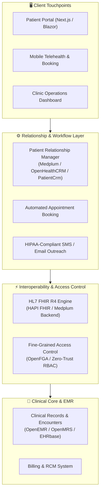

# 🏥 Awesome Healthcare CRM & Patient Relationship Management

  
  
  
  
  
  

**A curated index of enterprise SaaS products, open-source EHRs, and clinical workflow platforms.**  
*Empowering health systems, ambulatory clinics, and healthtech developers to build compliant, patient-centric operations.*

**Last updated: October 2026**

---

## 📑 Table of Contents

- [🔍 Overview & SEO Highlights](#-overview--seo-highlights)
- [📊 Sector Overview & Market Dynamics](#-sector-overview--market-dynamics)
- [🏢 SaaS & Enterprise Healthcare CRM Platforms](#-saas--enterprise-healthcare-crm-platforms)
- [🔓 Open-Source Healthcare CRM & Clinical Systems](#-open-source-healthcare-crm--clinical-systems)
- [🏗️ Architectural Blueprint: Building a Modern Healthcare CRM](#️-architectural-blueprint-building-a-modern-healthcare-crm)
- [🤝 How to Contribute](#-how-to-contribute)
- [⚖️ Regulatory & Compliance Disclaimer](#️-regulatory--compliance-disclaimer)
- [💖 Support & Sponsoring](#-support--sponsoring)
- [📈 Star History](#-star-history)

---

## 🔍 Overview & SEO Highlights

**Healthcare Customer Relationship Management (Healthcare CRM)** platforms — also referred to as **Patient Relationship Management (PRM)** systems — bridge the gap between transactional Electronic Health Records (**EHR/EMR**) and modern consumer engagement. Unlike traditional corporate CRMs, healthcare-grade solutions must natively accommodate:

- 🛡️ **Regulatory Rigor**: Stringent compliance with **HIPAA**, **HITECH**, **GDPR**, and SOC 2 Type II data safeguards.
- 🔄 **Clinical Interoperability**: Seamless data exchange via **HL7 v2**, **FHIR (Fast Healthcare Interoperability Resources) R4**, and DICOM standards.
- 🧑‍⚕️ **Care Coordination & Patient 360**: Unified views combining clinical history, social determinants of health (SDOH), communication logs, and active care plans.
- 📅 **Intelligent Scheduling & Intake**: Automated digital check-in, two-way SMS appointment confirmations, and tele-triage queues.

Whether deploying enterprise SaaS to orchestrate multi-hospital patient journeys or self-hosting open-source clinical stacks for data sovereignty, this directory provides the most comprehensive architectural reference available.

---

## 📊 Sector Overview & Market Dynamics

The global healthcare CRM market is valued at approximately **$19.5 billion to $21.5 billion** in 2025–2026 and is projected to expand to **$23.3 billion+** by 2027, growing at a robust compound annual growth rate (**CAGR of 8.5% to 12.3%**).

### Market Concentration & Fragmentation Analysis
- **Enterprise Concentration (Tier-1 Systems)**: The enterprise acute-care and nationwide hospital network market is **moderately concentrated**, anchored by entrenched giants such as **Oracle Health (Cerner)**, **Salesforce Health Cloud**, **Veeva Systems**, and **Epic Systems**. These category leaders command strong moats through deep EHR lock-in and multi-year health system Master Services Agreements (MSAs).
- **Sub-Sector Fragmentation (Tier-2 & Outpatient)**: Conversely, the mid-market, ambulatory clinic, specialty practice, and digital health/telemedicine sectors remain **highly fragmented**. Hundreds of specialized vendors, regional CRM platforms, and emerging headless open-source stacks compete aggressively on specific niches (e.g., patient intake automation, dental/ophthalmology workflows, behavioral health CRM, and FHIR-native developer APIs).

---

## 🏢 SaaS & Enterprise Healthcare CRM Platforms

The following enterprise platforms represent the leading commercial SaaS solutions in healthcare relationship management, sorted in **descending order of company scale** (market capitalization / enterprise valuation and annual revenue).

| Platform | Company Scale (Valuation / Revenue) | Starting Pricing (Specific Tier) | Free Tier / Trial Limit | Core Healthcare Focus & Strengths |
| :--- | :--- | :--- | :--- | :--- |
| **[Oracle Health (Cerner HealtheIntent)](https://www.oracle.com/health/)** | **~$430B Market Cap** • $67.4B Annual Revenue (Oracle) | **$25 / user / month** *(Entry cloud EHR tier; enterprise HealtheIntent population health quoted per covered life from ~$1.5M/yr)* | **0-day clinical trial** *(No free clinical trial; includes 30-day developer cloud sandbox on Oracle OCI with $300 free credits)* | Enterprise population health analytics, longitudinal patient records across multi-hospital networks, and clinical data aggregation. |
| **[Salesforce Health Cloud](https://www.salesforce.com/products/health-cloud/overview/)** | **~$290B Market Cap** • $34.9B Annual Revenue (Salesforce) | **$325 / user / month** *(Enterprise Edition, billed annually; $500/user/mo for Unlimited Edition)* | **30-day free trial** *(No credit card required; includes pre-configured healthcare workflows, Patient 360 console, and sample clinical datasets)* | Omni-channel patient 360 management, care coordination plans, intelligent call centers, and clinical conversational AI agents. |
| **[Veeva Systems (Vault CRM)](https://www.veeva.com/)** | **~$46B Market Cap** • $3.19B Annual Revenue | **$140 / user / month** *(Base commercial CRM tier; typical enterprise life sciences agreements from ~$50,000/yr)* | **Free forever tier via SiteVault** *(Veeva SiteVault Free allows up to 20 active clinical studies with unlimited user seats; 0-day trial for enterprise CRM)* | Life sciences, biotechnology, and pharmaceutical relationship management; clinical trial site monitoring and compliant medical engagement. |
| **[Epic Healthy Planet](https://www.epic.com/)** | **~$35B – $45B Valuation** • $5.7B Annual Revenue (Private) | **$200 / user / month** *(Hosted ambulatory tier; health system deployment contracts range from $100K to $10M+)* | **0-day free trial** *(No free trial or freemium tier due to deep hospital infrastructure setup; interactive guided demonstrations available)* | Deeply integrated population health module within Epic EHR; automated care gap identification, risk stratification, and MyChart patient outreach. |
| **[Mercury Healthcare (WebMD Ignite)](https://www.webmdignite.com/)** | **~$12B Valuation** • $2.8B WebMD acquisition (KKR / Internet Brands) | **$2,083 / month** *(Starting health system engagement contract from ~$25,000/year base tier)* | **0-day free trial** *(No self-serve trial; offers custom proof-of-concept sandbox access and patient journey data audits upon consultation)* | Health system patient acquisition, predictive patient journey modeling, omnichannel clinical marketing, and physician alignment CRM. |
| **[Innovaccer](https://innovaccer.com/)** | **$3.5B Valuation** • ~$252M Annual Run-Rate Revenue | **$8,333 / month** *(Starting Data Activation Platform tier from ~$100,000/year; or $0.50–$1.50 per member per month)* | **0-day public trial** *(No self-service free trial; offers custom 14-day guided proof-of-concept sandbox demo for qualified health systems)* | Healthcare Data Activation Platform (DAP), unified patient record consolidation, value-based care management, and AI copilot clinical workflows. |
| **[WellSky](https://wellsky.com/)** | **$3.0B Valuation** • ~$600M Annual Revenue (TPG / LGP backed) | **$50 / user / month** *(Or $1,000/month agency tier for up to 50 active patients/day; onboarding fees apply)* | **0-day free trial** *(No free trial or freemium tier available; scheduled live workflow simulations provided upon request)* | Post-acute care CRM, home health & hospice care coordination, social determinants of health (SDOH) referral networks, and rehabilitation analytics. |
| **[Healthgrades (Elevated Profiles)](https://www.healthgrades.com/)** | **~$1.1B Valuation** • Operating division of WebMD Ignite | **$49.95 / month** *(Elevated Provider Profiles, billed at $479.40/year per physician)* | **Free forever basic tier** *(Claimed doctor profiles with contact details, specialty tags, and verified reviews are free forever; 0-day trial for premium)* | Premier consumer physician search engine, patient acquisition campaigns, online appointment scheduling integration, and doctor reputation management. |
| **[LeadSquared Healthcare](https://www.leadsquared.com/healthcare-crm/)** | **$1.0B Valuation** • ~$50M Annual Revenue (Unicorn) | **$25 / user / month** *(Lite tier, billed annually; $60/user/mo for Sales Pro tier)* | **15-day free trial** *(No credit card required; full access to patient intake automation, lead tracking, and omnichannel appointment booking)* | High-velocity patient intake automation, call-center patient routing, omni-channel appointment booking, and clinic marketing automation. |
| **[CareCloud](https://www.carecloud.com/)** | **~$85M Market Cap** • ~$115M Annual Revenue (NASDAQ: CCLD) | **$349 / provider / month** *(CareCloud Central PM; $629/provider/mo for Complete EHR + PM bundle)* | **0-day free trial** *(No self-serve free trial; offers 1-on-1 personalized workflow demonstration and revenue cycle management audits)* | Medical practice management, ambulatory EHR, patient portal and scheduling, and tech-enabled revenue cycle management (RCM). |

---

## 🔓 Open-Source Healthcare CRM & Clinical Systems

Open-source healthcare systems give clinics, developers, and sovereign institutions total control over patient data, zero per-seat licensing fees, and full auditing capabilities.

The repositories below are ranked in **descending order by GitHub star count**. Each badge links directly to that repository's stargazers page:

1. **[HospitalRun](https://github.com/HospitalRun/hospitalrun-frontend)**   
   *Offline-first electronic health record and hospital information system.*  
   Built specifically for resource-constrained environments and developing world hospitals. Provides full patient management, appointment scheduling, laboratory order tracking, and medication billing with synchronized offline operation.

2. **[OpenEMR](https://github.com/openemr/openemr)**   
   *ONC-certified open-source electronic health records and medical practice management suite.*  
   The world's most widely installed open-source EHR. Includes patient relationship portals, medical billing, e-prescriptions, clinical decision support, scheduling, and multi-language support. Fully certified for meaningful use and regulatory reporting.

3. **[Fasten Health](https://github.com/fastenhealth/fasten-onprem)**   
   *Self-hosted personal EHR and unified patient portal.*  
   Integrates directly with over 100,000 healthcare institutions using FHIR and SMART-on-FHIR protocols. Empowers patients and independent clinics to centralize longitudinal medical histories in a single, privacy-focused dashboard.

4. **[Medplum](https://github.com/medplum/medplum)**   
   *Headless healthcare platform, FHIR backend, and patient CRM.*  
   A developer-centric platform that provides a fully compliant HL7 FHIR server, automated clinical bot workflows, patient identity management, React component libraries, and GraphQL/REST APIs for building custom patient portals and medical CRMs.

5. **[HAPI FHIR](https://github.com/hapifhir/hapi-fhir)**   
   *Complete Java implementation of the HL7 FHIR specification.*  
   The industry-standard open-source FHIR server and client library. Powers data interoperability layers across healthcare enterprises, connecting legacy clinical data warehouses to modern CRM endpoints.

6. **[OpenMRS Core](https://github.com/openmrs/openmrs-core)**   
   *Enterprise open-source medical record system for global health.*  
   Designed to combat systemic health crises worldwide. Features a modular architecture supporting patient registry management, clinical encounters, regimen tracking, and cross-clinic reporting.

7. **[Open Hospital](https://github.com/informatici/openhospital)**   
   *Hospital information and clinical records management application.*  
   Engineered for mission hospitals and rural clinics. Features outpatient registration, inpatient ward tracking, pharmacy stock management, lab tests, and customizable patient billing modules.

8. **[Marley Health (Frappe Health)](https://github.com/earthians/marley)**   
   *Enterprise health information system built on Frappe and ERPNext.*  
   Blends full enterprise resource planning with patient management. Supports inpatient/outpatient encounters, rehabilitation therapies, clinical procedure logging, and HL7 FHIR standard mappings.

9. **[CARE (Open Healthcare Network)](https://github.com/ohcnetwork/care)**   
   *Digital public good for decentralized healthcare administration.*  
   Developed during pandemic response initiatives, CARE provides tele-ICU administration, patient admission pipelines, bed capacity management, and triage tracking across state-level health infrastructures.

10. **[EHRbase](https://github.com/ehrbase/ehrbase)**   
    *Open-source openEHR clinical data repository.*  
    Decouples clinical data storage from applications using standardized openEHR archetypes, ensuring medical data remains vendor-neutral, future-proof, and accessible across future CRM modules.

11. **[LibreHealth EHR](https://github.com/LibreHealthIO/lh-ehr)**   
    *Modernized clinical practice and patient records management.*  
    An evolution of open-source EHR architecture emphasizing usability, clinical decision tools, automated prescription tracking, and appointment scheduling.

12. **[Bahmni Core](https://github.com/Bahmni/bahmni-core)**   
    *Integrated hospital management and clinical workflow stack.*  
    Combines OpenMRS, Odoo ERP, and OpenELIS laboratory software into an integrated hospital solution for patient records, billing, inventory, and clinical workflows.

13. **[Imhotep Smart Clinic](https://github.com/Imhotep-Tech/imhotep_smart_clinic)**   
    *Modern clinic management built with Django and TailwindCSS.*  
    Features digital health records, prescription management, progressive web app (PWA) patient scheduling, and practice analytics.

14. **[VITALIt OS](https://github.com/basedavishkar/vitalit-os)**   
    *Free, lightweight hospital management and patient routing software.*  
    A self-hostable system built with modern web tech to replace legacy enterprise tools. Includes doctor scheduling, role-based access control, billing, and real-time operations dashboards.

15. **[PatientCrm](https://github.com/dotnetappdev/PatientCrm)**   
    *Zero-trust patient CRM engineered with .NET 10 & Blazor.*  
    Features role/claims-based authorization, FIDO2/WebAuthn passkeys, TOTP two-factor authentication, secure cookie policies, and REST APIs for patient profile management.

16. **[OpenHealthCRM](https://github.com/pras75299/OpenHealthCRM)**   
    *Multi-tenant clinic CRM built on Next.js 16 and Prisma.*  
    Features staff RBAC, patient onboarding, appointment bookings, encounter logging, billing, and live vitals streaming over WebSockets.

17. **[BHIMA](https://github.com/Ebed-meleck/bhima)**   
    *Rural hospital information and medical billing management system.*  
    Built to scale from single dispensaries to multi-hundred-bed hospitals. Handles patient accounts, pharmacy inventories, budgeting, and insurance claims.

---

## 🏗️ Architectural Blueprint: Building a Modern Healthcare CRM

When designing an internal healthcare CRM platform, combine specialized open-source layers for complete security, interoperability, and UX:

---

## 🤝 How to Contribute

Contributions are warmly welcomed! Help keep this healthcare ecosystem up-to-date:

1. 🍴 **Fork the repository** on GitHub.
2. 🌿 **Create a new branch**: `git checkout -b feature/add-new-healthcare-tool`
3. 📝 **Add your tool** following the existing format:
   - For SaaS products: Include exact starting tier pricing, specific free trial limits, company valuation/revenue, and primary capabilities.
   - For Open-Source tools: Include GitHub repository link, social star badge, and architectural summary.
4. 🚀 **Submit a Pull Request** with a concise description of why the tool belongs in this curated index.

---

## ⚖️ Regulatory & Compliance Disclaimer

- 📌 **Informational Purpose Only**: This repository is a community-curated index. Listing does not imply an official endorsement or legal compliance guarantee.
- 🔒 **Data Protection Standards**: Any production healthcare CRM deployment handling Protected Health Information (**PHI**) in the United States must execute a **Business Associate Agreement (BAA)** and comply with **HIPAA & HITECH** guidelines. European deployments must adhere to **GDPR** Article 9 requirements for sensitive health data.
- 🛡️ **Self-Hosted Security**: Self-hosting open-source clinical platforms requires explicit hardening, end-to-end encryption (TLS 1.3 / AES-256), strict audit logging, and continuous vulnerability scanning.

---

## 💖 Support & Sponsoring

Thank you for exploring and utilizing **Awesome-Healthcare-CRM**! If this curated guide helps your clinic, health system, research, or development project, please consider supporting the project:

- ⭐ **Star this repository** to improve discoverability for other healthcare technologists
- 🍴 **Fork and contribute** your favorite tools, case studies, or open-source modules
- 📢 **Share with peers**, clinical engineers, and healthcare IT communities
- ☕ **Support the maintainer**: Buy me a coffee or become a sponsor at the [GitHub Sponsor Dashboard](https://github.com/sponsors/ishandutta2007)

Every contribution and star fuels further curation and ecosystem updates!

---

## 📈 Star History

---

  Maintained with ❤️ by <a href="https://github.com/ishandutta2007">Ishan Dutta</a> and the Healthcare Open-Source Community.

